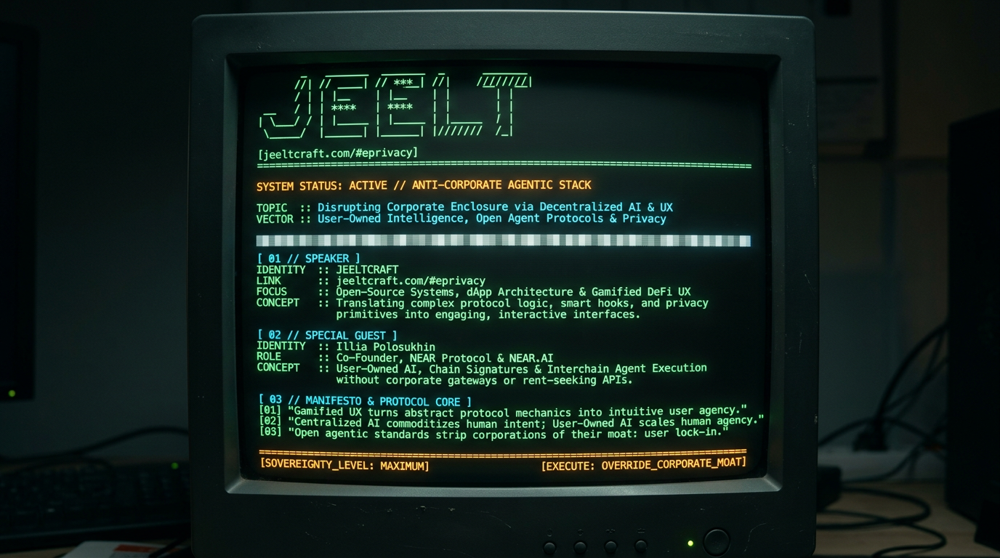

# To-Do 

We will lead students through the creation of an IronClaw skill that registers a trading agent via the Agent Connect demo API (`demo.agentsonintents.com`). The student work based on our example path will be published as a standalone repo on IronHub, with rewards tied directly to the repo's star count.


## Timeline


| Phase | What gets built | Deliverable |
|---|---|---|
| Step 1 | Skill repo scaffold — `manifest.toml`, skill markdown, `[[tools.credentials]]` block wired to `demo.agentsonintents.com` | Working local skill, installable via `ironclaw ironhub install` |
| Step 2 | Agent Connect integration — `http_request` call to `createAgent`, `use_secret` for API key, host pinned to demo endpoint | Skill registers a trading agent end-to-end against the demo API |
| Step 3 | Guard/Envoy test alignment — credential rule test (exact host, no wildcards) + network rule test (`http_request` only) | Skill passes both Phase 2 drone tests |
| Step 4 | IronHub publish — repo URL linked in manifest, skill submitted to catalog, signature/pinning flow completed | Skill live on IronHub, installable by anyone |
| Step 5 | Star-reward layer — `repo_url` field confirmed in manifest, star-count sync job, reward-tier threshold table, payout mechanism | Stars on the skill's repo automatically map to a reward tier for the author |
| Step 6 | Polish + docs — README, install instructions, example `use_secret` setup, reward-tier display on IronHub listing | Fully documented, self-serve skill with visible star/reward status |


## Star-Reward Model


Each skill is its own standalone repo. The star count of that repo directly determines the author's reward tier — no API tier gating, no rate-limit coupling.


| Repo stars | Reward tier |
|---|---|
| 0–99 | Base |
| 100–499 | Tier 1 |
| 500–999 | Tier 2 |
| 1000+ | Tier 3 |


## Key Dependencies


- Agent Connect demo API must be stable.
- IronHub manifest schema must support a `repo_url` field for the star-reward link — confirm before Week 4.
- GitHub API rate limits for the star-count sync job — cache if catalog grows.


## Checks


Each phase has a concrete, verifiable check everyone can run or inspect to confirm the work is done — no vague "in progress" status.


| Phase | Check | How to verify | Pass criteria |
|---|---|---|---|
| Step 1 | Skill installs locally | Run `ironclaw ironhub install` on the repo | Skill appears in local IronClaw catalog, `manifest.toml` parses without error |
| Step 2 | Agent registers via demo API | Run the skill against `demo.agentsonintents.com` with a test API key | A trading agent is created and returns a valid agent ID from `createAgent` |
| Step 3 | Guard + Envoy tests pass | Run IronClaw's Phase 2 credential/network rule tests | Both tests return pass — exact host match, no wildcards, `http_request` only |
| Step 4 | Skill is live on IronHub | Search IronHub catalog for the skill | Skill is listed, signed, pinned, and installable by a third party |
| Step 5 | Star-reward sync works | Push a test star count (or mock) and check reward tier updates | Reward tier matches the threshold table for the current star count |
| Step 6 | Docs + install flow complete | Fresh-clone the repo, follow README, install + run | A new user can install and register an agent without manual config beyond their own API key |


## How to Run the Checks


Each check is a single command or a short script — no manual inspection needed:


```bash
# Week 1: install check
ironclaw ironhub install ./ice-finder


# Week 2: registration check
ironclaw run ./ice-finder --test-register


# Week 3: Guard/Envoy test check
ironclaw test ./ice-finder --suite guard,envoy


# Week 4: IronHub live check
ironclaw ironhub search ice-finder


# Week 5: star-reward sync check
ironclaw test ./ice-finder --suite reward-sync


# Week 6: fresh-install check
git clone <repo> && cd ice-finder && ironclaw ironhub install . && ironclaw run . --test-register
```


## Reporting Cadence


| Cadence | What gets reported |
|---|---|
| End of each day | Checkpoint table updated: pass/fail per check, with command output attached |
| End of Day 3 | Mid-point review — Guard/Envoy results shared with investor |
| End of Day 6 | Final review — full checklist green, live IronHub link, star-reward demo |


# How to Play


## VESPER / BELTER — How to Play


You operate a three-legged arachnoid miner on a rugged asteroid. As it mines, deploys drones, and builds a colony, you create a simple IronClaw skill: a Markdown guide that tells an agent when to use a survey tool, what information to ask for, and how to present the results.


Your skill has one real job: **register a trading agent with the Agent Intents demo API** (`demo.agentsonintents.com`). By the end of the run, the colony's survival depends on that registration succeeding through a properly permissioned, properly credentialed tool call.


Think of the skill as the colony's operating instructions and tools as its machinery. The skill guides; the tools act. You'll learn how an agent calls tools with structured JSON arguments, and how those tools reach an external service — the Agent Intents API — through controlled, permissioned HTTP requests.


Each stage of construction teaches part of that connection: assemble the tool's manifest, declare the Agent Intents API as a credentialled vendor, define its permissions and accepted inputs, test that the API call is safe, then inspect, install, and review your generated skill in the simulated IronHub console and review panel.


Verification is life support. Your colony reaches 100% O2 only when the installed artifact is pinned to an exact digest, you have reviewed the skill before trusting it, **and the Agent Intents registration path is confirmed safe**.


Drag to orbit the scene and scroll to zoom. The camera never affects progress.


## THE CONSOLE AT A GLANCE


### Top bar
- O2 %, manifest completeness, hex integrity %. O2 turns amber when you installed without a pin.
- In the centre: the trust tier and the current O2 ceiling. Press it to open the verification panel.
- On narrow screens the centre readout is replaced by a hexagon button that opens the same panel.


### Verification panel
- The package's sha256 artifact digest as a 16 x 4 grid, with the trust tier under it, you access that info tapping the info displayed in the center of your navbar or with the hexagon button on mobile. Dim means unverified. Lit means pinned. Red means a mismatch. Below the grid: package name, version, provenance, pin status, the current O2 ceiling, and the exact requirement that lifts it. A copy button puts the full digest on the clipboard. The pin and review actions live here.


### Left rail
- The current mission: an objective, the exact technical task, the candidate fragments, and what a wrong pick costs, stated before you choose. Under it, the phase checklist and "Why this rule", which quotes the documentation the rule comes from.


### Right
- Provenance of the package and its origin gate matrix.


### Bottom
- A simulated IronHub console. Type help for commands.
- reset wipes the save and starts a new run immediately (same as Start over below).


### ?
- Opens this guide.


## PHASE 1 — MINING = BUILD A PACKAGE


Every prospector files a claim before the first core comes up. The package you build here is yours: your name on the hub, your one-line purpose, your manifest. Two players never ship the same skill, and the sha256 digest the rest of the game pins and reviews is the hash of the header you type.


The first core sample is the claim. The rail tells the story and asks for three things:


- **Claim name** what you trade under on the hub (letters, digits, hyphens; e.g. ice-finder)
- **What it does** one line for the buyer
- **Manifest header** written your way, with one hard rule: it must contain the line
  `schema_version = "reborn.extension_manifest.v3"`


That line is the only thing checked. A header without it is refused and spends the sample. A header opening with a legacy shape ([[host_api]], [capability_provider.tools], [[capabilities]]) jams the excavator. When it validates, your name appears in the checklist, the fragments that follow are written against your tool id (ice-finder becomes ice.finder), and the console, the review and the survey all carry your skill, not a sample one.


After the claim, the excavator surfaces a core sample every couple of seconds. The rack in the rail has three slots; a filled slot is a sample waiting, an empty one means extraction is still running. Selecting a slot inspects it and costs nothing; only picking a fragment spends it. Each sample lets you attach one more field to manifest.toml. The rail shows the field and two or three candidate fragments. Pick one.


- A valid fragment ticks the checkbox, spends the sample, and the miner's hull pulses once in the scene.
- An invalid fragment is refused. A repair panel stays in the rail with the error code, what was wrong, what to change, and what it cost, until you dismiss it. The sample is spent; wait for the next one. Fields you already attached stay attached.
- A legacy v2 shape ([[host_api]], [capability_provider.tools], [[capabilities]]) jams the excavator for a moment. The robot stops, a warning explains why, and the sample is lost.


The five fields, in order:


1. Your claim: the manifest header with `schema_version = "reborn.extension_manifest.v3"`
2. One [[tools]] entry with an origin_gate_matrix. loop_run must be "gated_unless_granted". An omitted origin is "forbidden". "ungated" needs a security review, not a manifest edit.
3. input_schema_ref, output_schema_ref, prompt_doc_ref as relative package paths. No absolute paths, no "..".
4. **A [[tools.credentials]] block declaring `agentsonintents` as the vendor, with a matching `[auth.agentsonintents]` recipe pinned to the exact demo host `https://demo.agentsonintents.com`.** This is where the Agent Intents API enters the build: the skill declares *which external service* it will talk to and *how* it authenticates, before it ever makes a call. The API key itself is never written here — only a reference to it via `use_secret`.
5. An input schema with additionalProperties: false.


When all five validate you see "Package valid. Hex assembly unlocked." and the drones launch.


## PHASE 2 — TEST YOUR TOOL BEFORE IT TOUCHES THE WORLD


Your manifest says what your tool is allowed to do.
Now you have to prove it actually behaves that way — **including how it talks to the Agent Intents API**.


Five drones fly to the worksite and begin assembling the glass hex habitat. Each drone carries one safety rule your tool must follow before it can interact with anything outside the colony:


### Envoy — NETWORK RULE
- Your tool cannot make web requests on its own. If it needs data from the internet, it must ask the host through the http_request import. This keeps the agent from calling arbitrary URLs behind your back.
- **For this skill, the only outbound call is the Agent Intents registration: an `http_request` to `https://demo.agentsonintents.com` to create the trading agent.** Any other host, or a direct fetch bypassing `http_request`, fails this test.


### Guard — CREDENTIAL RULE
- If your tool uses a password, API key, or token, it must request it through use_secret — never hardcode it. And when it connects to a service, it must name the exact host (like https://api.example.com), never a wildcard like *.example.com. This stops a stolen credential from being reused somewhere else.
- **For this skill, the Agent Intents API key must be pulled via `use_secret`, and the host must be the exact `https://demo.agentsonintents.com` — not a wildcard, not a different Agent Intents environment.** This is the credential half of the API integration: the key exists, but only this skill, against this exact host, can use it.


### Scribe — ERROR RULE
- When something goes wrong, your tool must return a clean, stable error code — not dump a raw response from another website. This keeps sensitive information from leaking into the agent's context.
- **If the Agent Intents API rejects the registration (bad key, rate limit, malformed payload), the tool must surface a clean error code — never the raw API response.** This keeps Agent Intents error payloads from leaking into the agent's context.


### THE RAIL
Each drone appears as a button showing its symbol, name, and state:
- **dim** = still flying to the worksite
- **amber** = on station, test ready
- **mint** = test passed, rule confirmed


Selecting a drone brings its test to the front. Selecting does not run or pass anything — you still have to choose the correct implementation.


For each test, pick the implementation that follows that drone's rule.
- A wrong pick names the test that failed and explains why.
- A correct pick seals one band of rings in the scene.


- manifest contract test → guard drone → first ring band
- runtime behavior test → envoy drone → second ring band
- integration test → scribe drone → third ring band


A band stays translucent until its test passes, then turns solid.


### THE WRITE CLEARANCE GATE
The last band belongs to your write tool, `<your-tool-id>_write`. This tool can change things outside the colony (external_write), so it is deliberately restricted: default_permission = "ask".


**In this skill's case, "outside the colony" means the Agent Intents API itself: registering a trading agent creates a real record on the demo service.** It renders amber — "awaits clearance" — until you explicitly grant write clearance in the rail. Nothing proceeds until you do.


This is the approval gate every write capability goes through: the tool declares what it wants to do, and you decide whether to allow it.


Granting clearance completes the phase:
"All tests pass. Publish unlocked."


## LIMITS


You are not just passing tests to unlock the next screen.
You are proving your tool is safe to let loose:
- it can't call the internet without permission — **the only permitted destination is the Agent Intents demo host**
- it can't leak or misuse credentials — **the Agent Intents API key stays behind `use_secret`, bound to one exact host**
- it can't leak raw error data — **Agent Intents API failures come back as clean codes, not raw payloads**
- and it can't write anything without you saying yes — **registering the trading agent requires explicit write clearance**


Only then is it ready to be published.


## PHASE 3 — VEGETATION AND ATMOSPHERE = PUBLISH, INSTALL, TRUST


Your package is now published to IronHub under your claim name (the guide uses ice-finder as the example). Use the console at the bottom. Commands follow the real CLI:


- `ironclaw ironhub search <keyword>`
- `ironclaw ironhub list [--kind tool|skill]`
- `ironclaw ironhub info <name> --kind tool|skill`
- `ironclaw ironhub install <name> --kind tool|skill [--expected-version "x"] [--expected-artifact-digest "sha256:..."] [--acknowledge-unverified] [--force]`


A sensible run:


1. `ironclaw ironhub search ice`


2. `ironclaw ironhub info ice-finder --kind skill`
   Prints provenance, version and the sha256 artifact digest. The digest appears in the center readout, still dim.


3. `ironclaw ironhub install ice-finder --kind skill`
   Refused. Your claim has provenance New, a community entry. The agent cannot install it on its own, and approving in chat does not set the acknowledgement the gate requires. A dialog asks for a human override; accepting re-runs the install with --acknowledge-unverified.


4. You are now Installed, but unpinned. O2 climbs slowly and stops at 55 %. The readout says "Thin atmosphere." **At this tier the skill's description is visible, but the Agent Intents registration logic is not yet active — the agent cannot yet call the API.**


5. Open the verification panel and press "Prepare pin command", or use the "Prepare pinned install" button in the rail. Either one fills the console with the install command using the version and digest you inspected, with --force, and puts the cursor at the end. It does not run it: read it, then press Enter. The prepared command never includes --acknowledge-unverified; the override dialog asks for that separately. A wrong digest flashes the grid red and is refused; everything you had stays installed. A correct one lights the grid cell by cell, and O2 now climbs to 90 %.


   The rail offers a "Prepare ..." button for each step (search, info, install, pinned install). They only fill the console. If you have typed something you have not sent, they ask before replacing it. Up and Down arrows in the console walk your command history.


6. Press "Promote to Trusted" in the verification panel. The review opens with the skill body split into sections. Each of the three checks names its evidence; press "Show evidence" to jump to the section, and the check unlocks once that section has been on screen. Confirm all three to enable "Promote to Trusted". "Keep as Installed" cancels and changes nothing. The review is bound to the digest you inspected: if the package changes under you, the review is discarded and must be started again.


   **One of the review checks is the Agent Intents call itself:** confirm the skill's `http_request` targets exactly `https://demo.agentsonintents.com`, pulls the key via `use_secret`, and requests write clearance before registering the agent. This is the moment the API integration stops being configuration and becomes an active, trusted capability.


### Trust tiers, as the game uses them:


- **Installed** `~/.ironclaw/installed_skills/<name>/`
  The model sees the description only, not the prompt body, and cannot activate the skill itself. **The Agent Intents registration path is dormant.**


- **Trusted** `~/.ironclaw/skills/`
  Full prompt body loaded; the agent activates it on its own. A trusted skill has the same execution power as you. **This is when the skill can actually call the Agent Intents demo API and register the trading agent — the colony's final life-support step.**


Pinned and Trusted together let O2 reach 100 %. The atmosphere ignites, the plants finish growing, and the colony is established.


## COMMISSIONING SURVEY


Once the colony is established, the rail offers "Open commissioning survey": a CAD-style plate of the colony as it stands, drawn from the live scene (you can orbit the 3D to control the image). Warm paper, graphite contours, the hex structure in teal, leader lines to the features that exist, and a verification record with the real values from your run: manifest, tests, write clearance, package, version, provenance, full digest, pin, trust tier, review, final O2.


**The survey also records the Agent Intents registration outcome: the demo host that was called, the credential method used (`use_secret`), and whether write clearance was granted before the trading agent was created.** This makes the API integration part of the permanent record, not just a step that happened mid-game.


- Survey view frames the colony for documentation. Current view uses your own camera. Neither moves the gameplay camera.
- Export PNG saves the plate. The preview stays open; export can be repeated.
- The plate carries a survey designation derived from a seed saved with your completed run, so reopening it keeps the same identity and the same facts. The drawing itself is of the scene as it is now; the scene is rebuilt when the page reloads, so the asteroid's exact shape can differ between sessions.
- It is an exterior survey. No interior geometry is simulated, and the plate says so. It is not an engineering certification, and the artifact digest on it is the package's, not a signature of the plate.


## THINGS WORTH KNOWING


- Progress is saved in this browser. Reloading restores it. "Start over" in this panel wipes it.
- You can play faster than the robot. At each phase boundary the rail shows a short handover ("Package valid. Next: test the habitat structure") with one button to continue; the scene catches up on its own.
- Every error names a code and tells you what to change. Open "Why this rule" in the rail for the documentation text behind it.
- The console only answers ironhub commands once Phase 3 begins.
- Keyboard works throughout: Tab moves between controls, Enter runs a console command, Esc closes any dialog.
